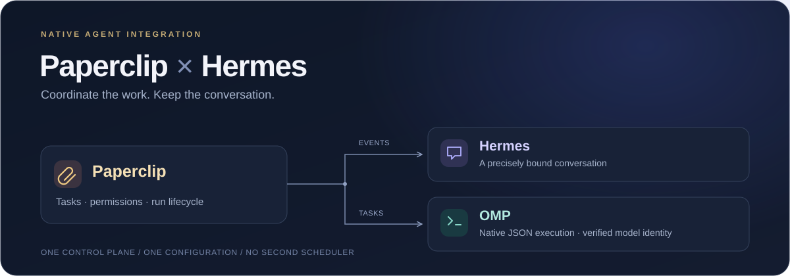

<div align="center">



# Paperclip × Hermes

**连接任务控制面与 Agent 会话，让协作回到同一条工作流。**

[](LICENSE)
[](package.json)
[](#quick-start)
[](https://github.com/Loveacup/paperclip-hermes-integration/actions/workflows/offline.yml)

[English](README.md) · **简体中文**

[快速开始](#quick-start) · [让 AI 帮你配置](#ai-setup) · [配置方法](#configuration) · [工作原理](#architecture) · [文档导航](#documentation)

</div>

---

把 **Paperclip** 的任务变化送回精确绑定的 **Hermes** 会话，同时保留 **OMP** worker 的原生执行路径。这是一层薄集成——不是另一套调度器、任务数据库，也不是绕过 Agent 的消息机器人。

> [!NOTE]
> **先在本地验证，再明确启用。** 快速开始只安装依赖、运行合成离线测试，不部署服务、不调用真实模型、不发送消息。

## ✨ 你会得到什么

| 组件 | 职责 | 带来的价值 |
|:--|:--|:--|
| **元信息事件桥** | 对账任务变化，唤醒原生 CEO heartbeat | 让任务变化回到既有管理工作流。 |
| **Hermes 插件** | 把事件指针注入明确绑定的会话 | 保留目标会话与群聊发送者隔离。 |
| **OMP 适配器** | 执行原生 JSON 任务，核对实际解析模型 | 支持逐任务模型覆盖，不替换执行引擎。 |
| **统一配置** | 一份非秘密 JSON，配套 schema 校验 | 改路径、换目标不必修改产品源码。 |

首次启动只建立基线，不重放历史。投递效果不确定时保留记录供核查，不盲目重试。

<a id="quick-start"></a>
## 🚀 快速开始

**环境要求：** Node.js **24.11.0+**、npm、Python **3.9+**，以及 macOS 或 Linux。

```sh
git clone https://github.com/Loveacup/paperclip-hermes-integration.git
cd paperclip-hermes-integration
npm ci
npm test
npm run config:check -- integration.example.json
```

**成功判据：** 依赖安装正常退出，测试全部通过、没有跳过，最后一条命令显示 `Configuration valid`。

默认测试使用合成 fixture，不依赖作者本机的 Hermes/OMP、真实凭据或私密捕获记录。准备真实安装时，再进入下面的配置流程。

## 分段 QA：分离机器执行与收口

当测试很快完成、模型驱动的报告收口却可能触及截止时间时，使用 **准备（OMP）→ 机器执行（专用 process、无模型）→ 收口（OMP＋固定 helper）**。冻结源、持久的单次执行准入和哈希绑定 receipt，让收口只验证、报告既有结果，不重跑 QA。证据不完整或原生写效果未知时停止并对账，不重放。

```sh
npm run test:segmented-qa
# 可选：包含三项真实 installed SDK 契约；宿主缺失明确失败。
npm run test:segmented-qa -- --paperclip-packages /absolute/node_modules/@paperclipai
```

内置参考产品实际运行 23 项 black-box 检查。组件默认测试可独立复现，只用本地 fixture；宿主测试将真实 process factory 接到**合成 localhost 端点**，不代表真实 Paperclip 授权通过。产品人工验收仍单独保留。

[组件命令与启用边界（英文）→](segmented-qa/README.md)。图构造器不创建任务、执行者或第二调度器。启用前需要准入 OMP／process 执行者及可达且允许的 API origin；原生发布器仅接受 HTTPS 或 loopback HTTP，不接受远端明文 HTTP。安装脚本本身不启用原生任务链，也不证明依赖自动唤醒已通过。

<a id="ai-setup"></a>
## 🤖 让 AI 帮你配置

**准备安装、修改路径或目标会话、排查配置失败时，先读 [AI 配置指南](docs/AI_SETUP.zh-CN.md)。** 指南按步骤说明参数来源、检查方法、启用边界和完成判据。

把下面这段话复制给你信任的本地编程助手：

```text
请帮我配置这个仓库。先阅读 docs/AI_SETUP.zh-CN.md、config.schema.json、
integration.example.json 和相关实现，在我授权的范围内核对环境与既有安装。
先做本地准备和校验，从 schema 生成字段清单；核实真实身份、路径及精确会话路由，
不能把合成示例当作实际参数。必要信息缺失时先询问。
密钥仅引用环境变量名称，不让我粘贴明文，也不暴露变量值。
保留已有配置和运行状态；启用前，针对具体宿主改动与测试取得我的明确同意。
最后报告实际命令、结果和未验证边界。离线测试通过不等于真实事件已被消费或用户可见。
```

想自己配置？[查看部署指南 →](docs/DEPLOYMENT.zh-CN.md)

<a id="configuration"></a>
## ⚙️ 一份配置，明确归属

建立本地配置，按实际环境修改，再校验与预览：

```sh
cp integration.example.json integration.local.json
npm run config:check -- integration.local.json
npm run setup -- integration.local.json
```

| 配置内容 | 可信来源 |
|:--|:--|
| API 地址、公司与 CEO 身份 | 已核实的 Paperclip 安装 |
| Hermes home、目标会话、发送者与 session key | 目标 Hermes 路由的精确元信息 |
| state/cursor 路径与 OMP 可执行文件 | 安装级选择，同时核对既有写入者 |
| 凭据 | 现有受保护的进程环境；JSON 只保存 `authEnv` 变量名称 |

[配置示例](integration.example.json) 是**合成数据**，默认关闭注入。[schema](config.schema.json) 定义实际字段；相对路径以 JSON 所在目录解析。本地配置和运行数据不进入 Git。

<details>
<summary><strong>预览不是部署：<code>--apply</code> 到底做什么？</strong></summary>

```sh
npm run setup -- integration.local.json --apply
sh -n .local/deploy.sh
```

这里只生成可审阅的 `.local/deploy.sh` 并检查语法，**不会执行部署**。生成脚本在任何宿主改动前，拒绝已存在的插件目标，包括目录、目录 symlink 和悬空 symlink。

Hermes 只保存 `config_path` 指针；Paperclip 的安装环境提供 `PAPERCLIP_INTEGRATION_CONFIG`。真正的插件启用、适配器注册和服务启动，分别按[部署指南](docs/DEPLOYMENT.zh-CN.md)执行。

修改 API/company/CEO 前，先核对状态归属。桥会拒绝身份不匹配或缺少身份的旧状态，不把旧 pending 工作带入新目标。

</details>

<a id="architecture"></a>
## 🧭 工作原理

```text
Paperclip task state ──► Metadata bridge ──► Native CEO heartbeat
                              │
                              └──────────► Bound Hermes conversation

Paperclip scheduling ──► OMP adapter ─────► Native OMP worker
```

**Paperclip 管任务、权限和运行生命周期；Hermes 承接选定会话；OMP 执行 worker 任务。** 本仓库连接三者的边界，不取代它们。

<details>
<summary><strong>仓库结构</strong></summary>

```text
event-bridge/           Metadata reconciliation, authenticated reads, ownership, health
tele-injection-plugin/ Owner-scoped configuration, exact routing, persistent cursors
omp-adapter/           Native JSON worker adapter and synthetic protocol fixtures
scripts/               Configuration validation, test tiers, deployment preview
docs/                  English and Chinese setup, deployment, compatibility guides
assets/                Original documentation artwork
```

</details>

## 🧪 分层验证，不夸大结果

| 层次 | 检查内容 | 入口 |
|:--|:--|:--|
| **离线回归** | 对账、路由、配置、进程生命周期与合成协议行为 | `npm test` |
| **宿主契约** | 明确配置的 Hermes/Paperclip 安装及 OMP 探针 | 下方显式命令 |
| **真实验收** | 获授权的安装、实际事件消费和用户可见投递 | 由操作者执行，不能由离线测试替代 |

<details>
<summary><strong>可选宿主检查与兼容性</strong></summary>

```sh
npm run test:host -- integration.local.json
npm run test:server -- integration.local.json
npm run test:installed-omp -- integration.local.json
```

宿主缺失或不兼容会明确失败，不静默跳过。最后一项会实际启动 OMP，但使用隔离 HOME 与合成离线 provider，不调用远端模型。

- **SDK 边界：** Paperclip SDK/Hermes adapter 固定为 `2026.1005.0`，显式核对内部 `buildPrompt` 导出。
- **Hermes 边界：** 必须验证目标安装的注入、生命周期和路由契约，不承诺任意版本通用。
- **OMP 边界：** 可执行文件是安装级配置，任务输入不能替换；区分请求模型与实际解析模型。
- **平台边界：** 使用 POSIX ownership locks；launchd 健康检查仅适用于 macOS。各提交的离线结果见 [CI](https://github.com/Loveacup/paperclip-hermes-integration/actions)。

</details>

> [!IMPORTANT]
> **`accepted` 不等于已消费，健康不等于已送达。** 独立版尚未完成真实部署和 Telegram 端到端闭环验收。工具权限不是 OS 沙箱，注入接口也没有原子的 session-id fence。启用前请阅读[兼容性与回滚](docs/COMPATIBILITY.zh-CN.md)。

<a id="documentation"></a>
## 📚 文档导航

| 我想做什么 | 简体中文 | English |
|:--|:--|:--|
| 让 AI 收集参数并校验配置 | [AI 配置指南](docs/AI_SETUP.zh-CN.md) | [AI setup](docs/AI_SETUP.md) |
| 安装插件、注册适配器并运行桥 | [配置与部署](docs/DEPLOYMENT.zh-CN.md) | [Deployment](docs/DEPLOYMENT.md) |
| 判断支持范围、安全退回 | [兼容性与回滚](docs/COMPATIBILITY.zh-CN.md) | [Compatibility](docs/COMPATIBILITY.md) |

## 🤝 参与贡献

欢迎小范围、带可复现测试的改动。先读[贡献指南](CONTRIBUTING.md)，执行快速开始中的检查；更新说明时同步维护两种语言。

不要提交私有配置、真实 ID、凭据、cursor、会话或运行输出。更新 SDK 或宿主接口时，明确说明契约变化。

## 📄 许可与致谢

本项目代码采用 **[MIT 许可证](LICENSE)**。Paperclip、Hermes、OMP 及其他依赖保留各自许可证，详见[第三方来源说明](THIRD_PARTY_NOTICES.md)。

基于 [Paperclip](https://github.com/paperclipai/paperclip)、[Hermes Agent](https://github.com/NousResearch/hermes-agent) 和 [oh-my-pi](https://github.com/can1357/oh-my-pi) 的能力构建。这是社区集成，不是上述项目的官方产品。
